# TP5 : Invocation de méthodes sur des objets distants avec Java RMI

**Étudiant(e) :** Islem Henteti  
**Classe :** LSI3  
**Module :** Développement d'applications réparties  
**Établissement :** Faculté des Sciences de Sfax  
**Année universitaire :** 2025-2026

---

# Introduction

Ce TP a pour objectif de mettre en pratique l'invocation de méthodes sur des objets distants avec Java RMI (Remote Method Invocation).

Il est composé de deux activités :

- **Activité 5-1 :** Réalisation d'un service de conversion de devise avec Java RMI.
- **Activité 5-2 :** Réalisation d'un service bancaire avec Java RMI et utilisation de JNDI pour la recherche des objets distants.

Les applications sont organisées selon une architecture client-serveur. Le serveur publie un objet distant et le client peut invoquer ses méthodes à distance.

---

# Activité 5-1 : Service de conversion de devise avec Java RMI

## 1. Présentation

Dans cette activité, nous avons développé un service de conversion de devise en utilisant Java RMI.

L'application est composée de deux projets indépendants :

- `RMIConversion_Server` : contient l'interface distante, son implémentation et le serveur RMI.
- `RMIConversion_Client` : contient le programme client qui invoque la méthode distante.

# Structure générale du TP

Le TP5 est organisé dans un dossier principal contenant les projets des deux activités, le fichier README et les captures d'écran.

Cette organisation permet de regrouper tous les fichiers nécessaires dans un seul dossier pour faciliter le dépôt du travail.

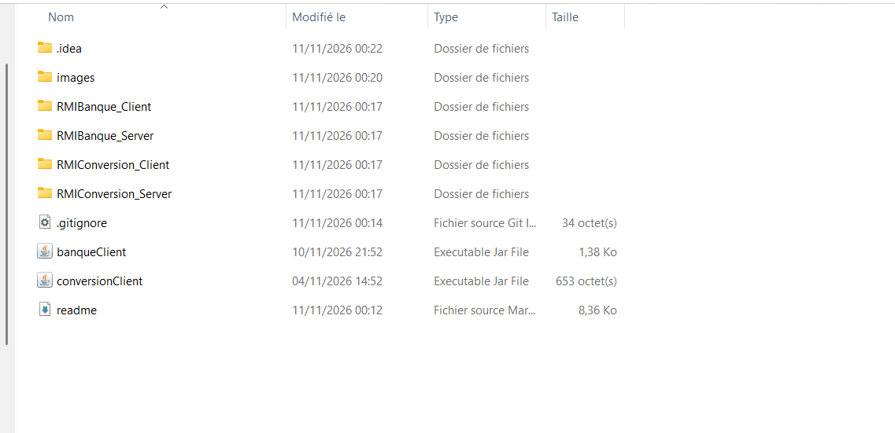

## 2. Création de l'interface distante

Nous avons créé le package `rmiService` et l'interface distante `IConversion`.

Cette interface déclare la méthode `convertirMontant(double mt)`, qui permet au client de demander une conversion à distance.

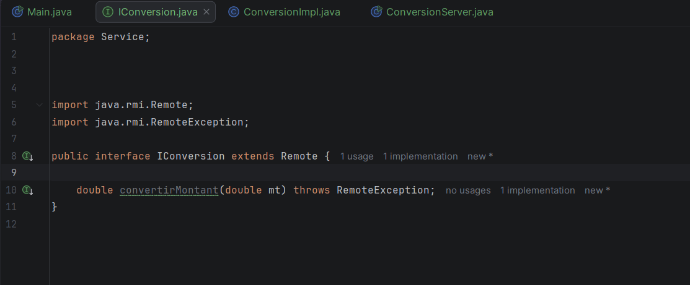

## 3. Implémentation du service distant

Nous avons créé la classe `ConversionImpl` qui implémente l'interface `IConversion`.

Elle contient le traitement de la conversion de devise.

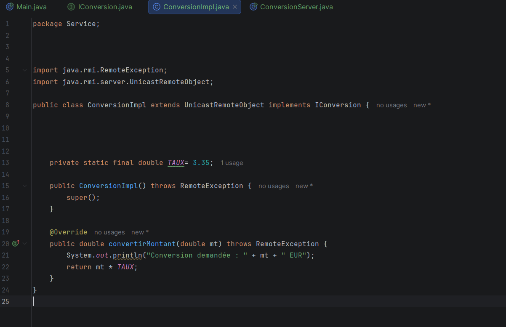

## 4. Création du serveur RMI

Nous avons créé le package `rmiServer` et la classe `ConversionServer`.

Le serveur permet de démarrer le registre RMI, de créer une instance du service distant et de publier cette instance afin qu'elle soit accessible par le client.

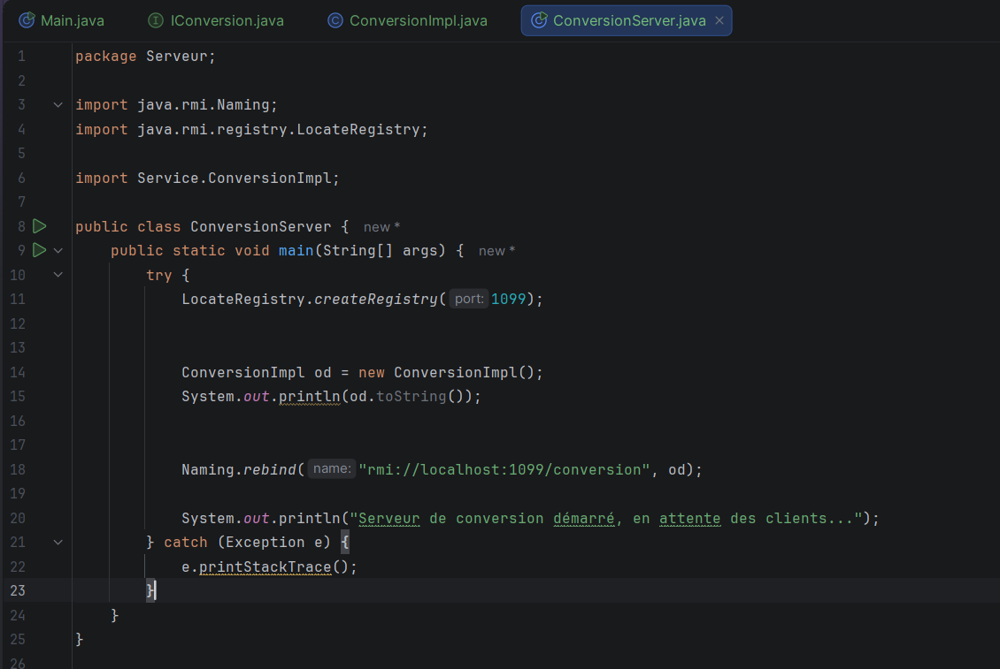

## 5. Compilation et création du fichier JAR

Nous avons compilé et préparé les classes nécessaires à la génération du fichier JAR contenant l'interface distante.

La création du JAR permet de partager l'interface avec le projet client sans lui transmettre l'implémentation du serveur.

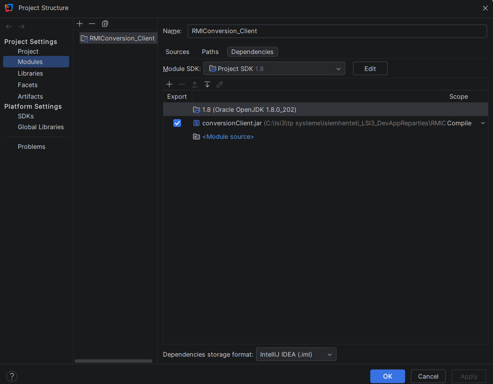

La commande de création du fichier JAR a été exécutée dans le terminal.

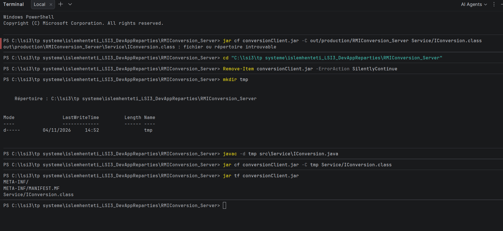

## 6. Création du client RMI

Nous avons créé le package `rmiClient` et la classe `ConversionClient`.

Le client recherche le service distant dans le registre RMI, récupère sa référence et invoque la méthode `convertirMontant()`.

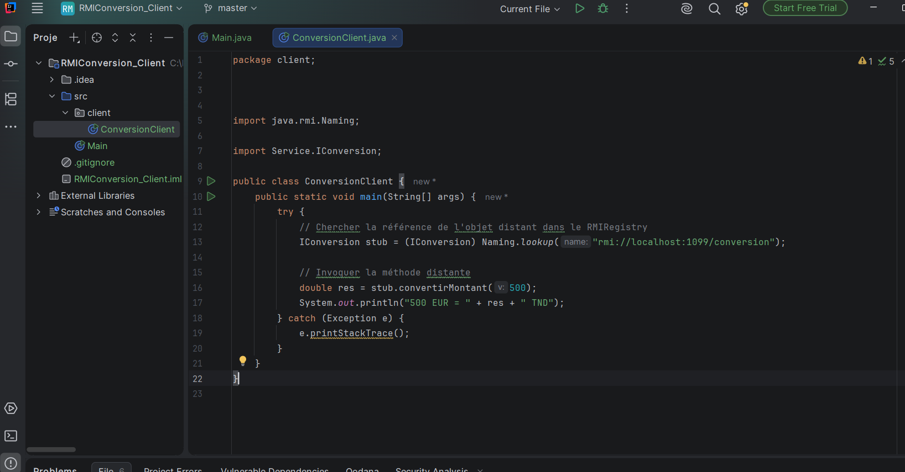

## 7. Exécution du serveur

Nous avons lancé le serveur RMI afin de démarrer le registre et de publier le service de conversion.

Le serveur doit rester actif pour permettre au client de communiquer avec lui.

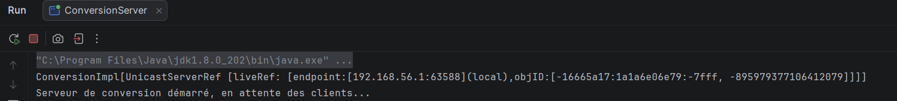

## 8. Exécution du client

Après le démarrage du serveur, nous avons exécuté le programme client.

Le client invoque la méthode distante pour convertir le montant demandé et affiche le résultat obtenu.

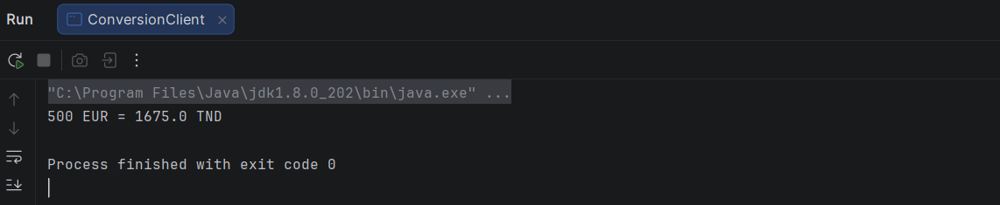

## 9. Vérification du fonctionnement

Cette étape permet de vérifier le fonctionnement de la communication entre le client et le serveur.

Le résultat affiché confirme que le client a pu invoquer la méthode distante.

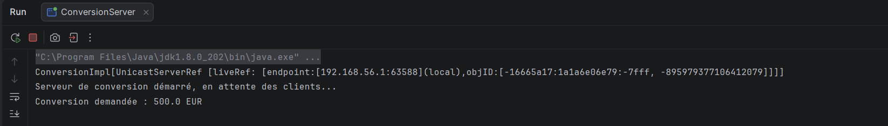

---

# Activité 5-2 : Service bancaire avec Java RMI et JNDI

## 1. Présentation

Dans cette activité, nous avons développé un service bancaire permettant de gérer des comptes à distance.

L'application permet principalement :

- De créer un compte bancaire.
- De consulter les informations d'un compte à partir de son code.
- De récupérer les informations du compte, notamment son solde et sa date de création.

Le projet est composé de deux parties :

- `RMIBanque_Server` : contient les classes métier, l'interface distante, son implémentation et le serveur.
- `RMIBanque_Client` : contient le programme client qui utilise les méthodes distantes.

## 2. Création de la classe Compte

Nous avons créé le package `metier` et la classe `Compte`.

Cette classe représente un compte bancaire et contient les informations suivantes :

- Le code du compte.
- Le solde.
- La date de création.

La classe doit être sérialisable pour permettre le transfert des objets entre le client et le serveur.

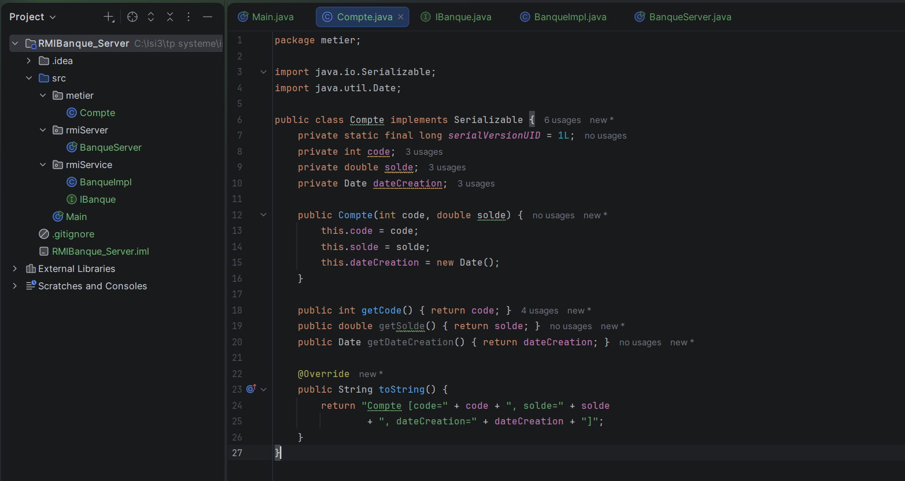

## 3. Création de l'interface distante IBanque

Nous avons créé le package `rmiService` et l'interface distante `IBanque`.

Cette interface déclare les méthodes permettant de créer un compte et de consulter ses informations :

- `creerCompte(Compte c)`
- `getInfoCompte(int code)`

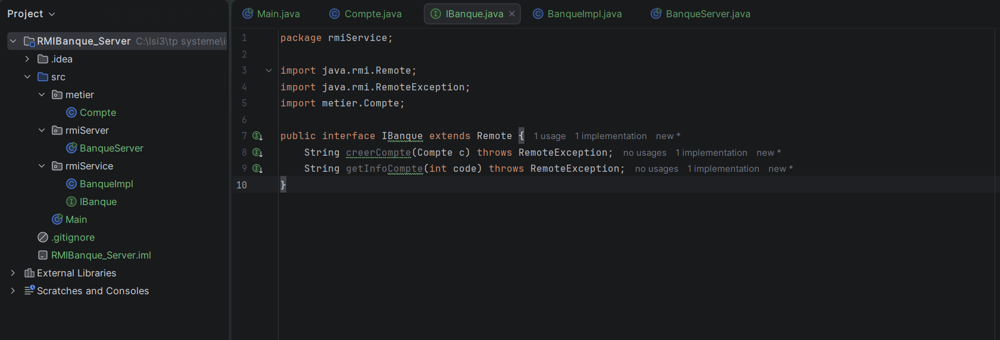

## 4. Implémentation du service bancaire

Nous avons créé la classe `BanqueImpl` qui implémente l'interface `IBanque`.

Elle contient le traitement des opérations bancaires demandées par le client.

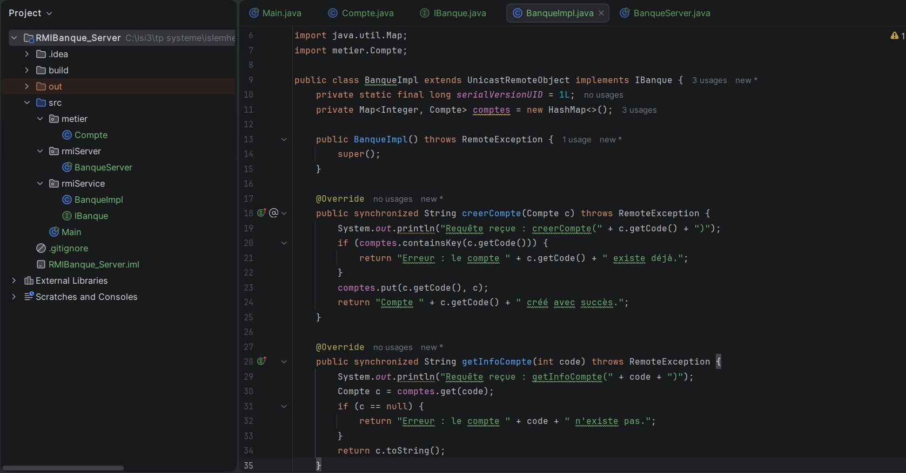

## 5. Création du serveur bancaire

Nous avons créé le package `rmiServer` et la classe `BanqueServer`.

Le serveur démarre le registre RMI, instancie le service bancaire et publie l'objet distant pour qu'il puisse être utilisé par les clients.

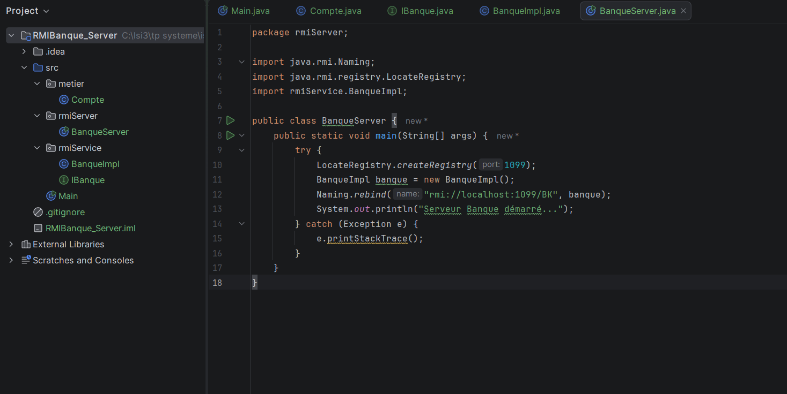

## 6. Compilation et création du fichier JAR

Nous avons préparé les classes nécessaires à la création du fichier JAR destiné au client.

Le fichier JAR contient les éléments partagés nécessaires à la communication, notamment l'interface distante `IBanque` et la classe métier `Compte`.

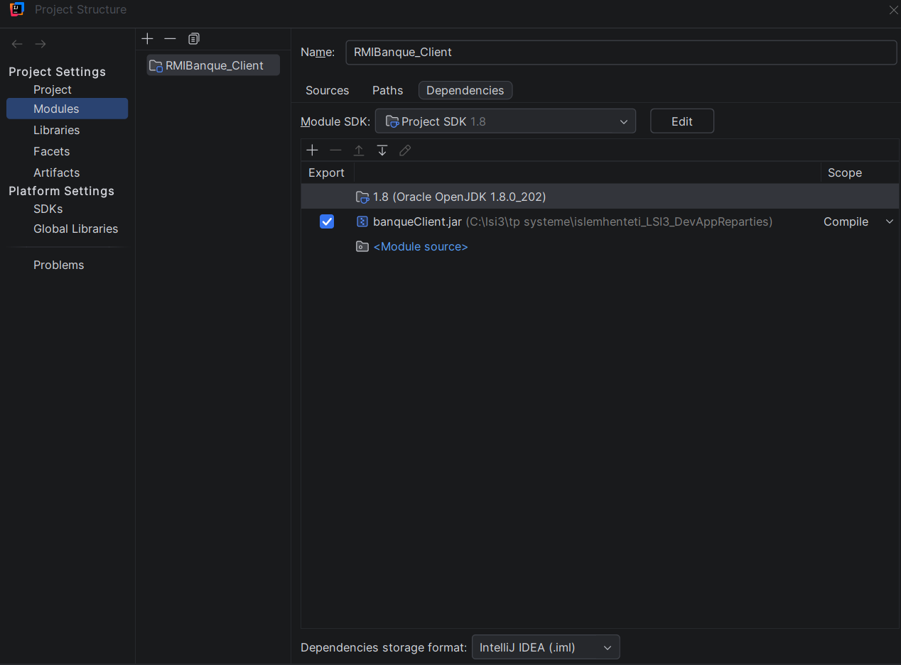

La commande de génération du fichier `banqueClient.jar` a été exécutée dans le terminal.

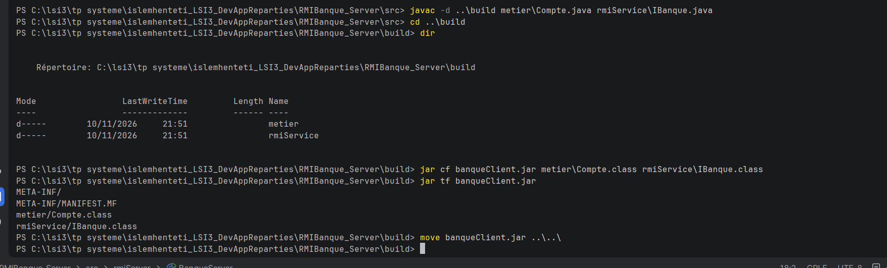

## 7. Création du client bancaire

Nous avons créé le package `rmiClient` et la classe `BanqueClient`.

Le client recherche le service bancaire distant, récupère sa référence et peut ensuite appeler les méthodes de l'interface `IBanque`.

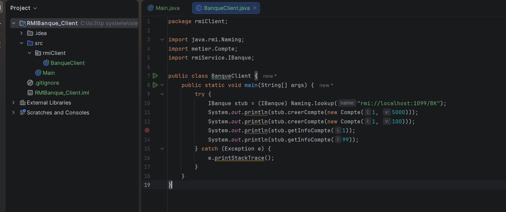

## 8. Exécution du serveur bancaire

Nous avons démarré le serveur bancaire pour publier le service distant dans le registre RMI.

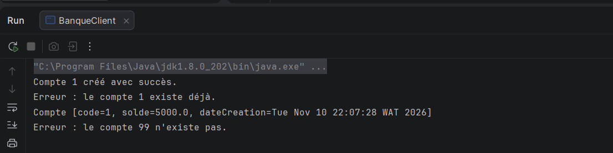

## 9. Exécution du client bancaire

Après le démarrage du serveur, nous avons lancé le client.

Le client effectue les opérations de création et de consultation d'un compte bancaire.

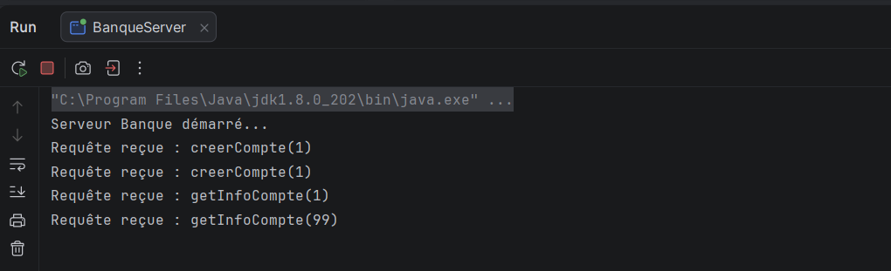

# Étape JNDI : Recherche du service bancaire avec JNDI

## 1. Présentation de JNDI

JNDI (Java Naming and Directory Interface) est une API Java qui permet de rechercher et d'accéder à des objets à partir d'un nom.

Dans cette étape, nous avons modifié l'accès au service bancaire distant pour utiliser JNDI au lieu de la recherche directe avec `Naming`.

## 2. Configuration du fichier jndi.properties

Nous avons créé le fichier `jndi.properties` dans le dossier `src` pour le cmient et serveur.

Ce fichier contient les propriétés nécessaires à la configuration de JNDI :

- La fabrique initiale : `com.sun.jndi.rmi.registry.RegistryContextFactory`.
- L'URL du fournisseur : `rmi://localhost:1099`.

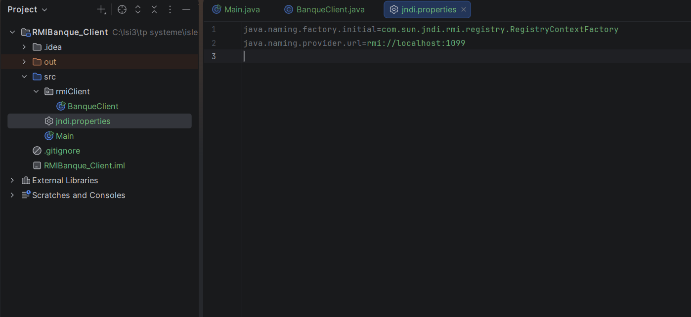
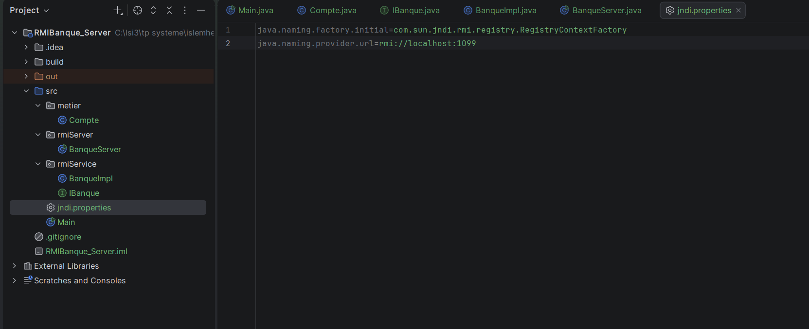

## 3. Modification du serveur

Nous avons modifié le code du serveur pour utiliser `InitialContext` et la méthode `rebind()`.

Cette méthode permet d'enregistrer l'objet distant sous un nom dans le contexte JNDI.

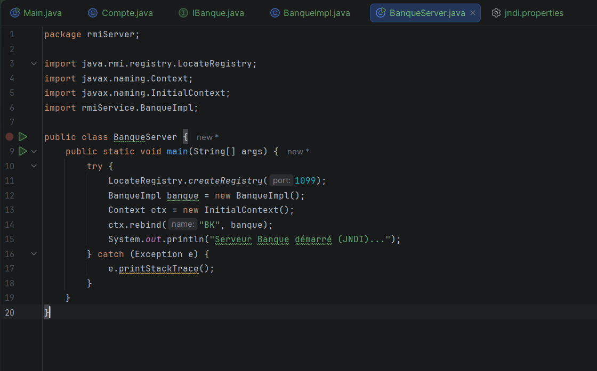

## 4. Modification du client

Nous avons modifié le code du client pour utiliser `InitialContext` et la méthode `lookup()`.

Cette méthode permet de rechercher le service bancaire distant à partir de son nom.

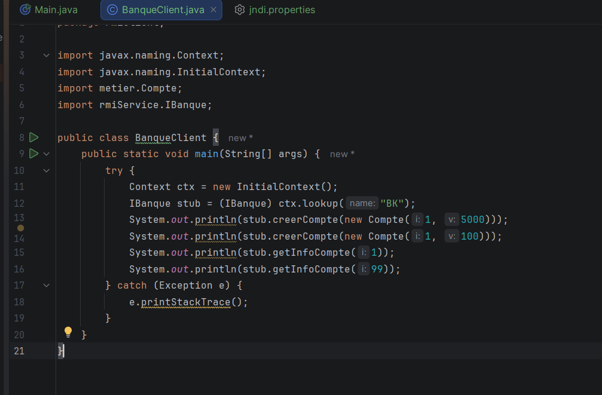

## 5. Exécution du serveur avec JNDI

Nous avons lancé le serveur après la modification de son code.

Le service bancaire est enregistré dans le contexte JNDI et devient accessible au client.

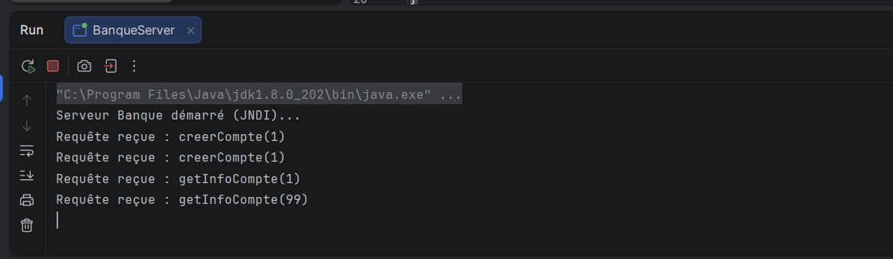

## 6. Exécution du client avec JNDI

Nous avons exécuté le client pour vérifier la recherche du service bancaire avec JNDI et effectuer les opérations bancaires.

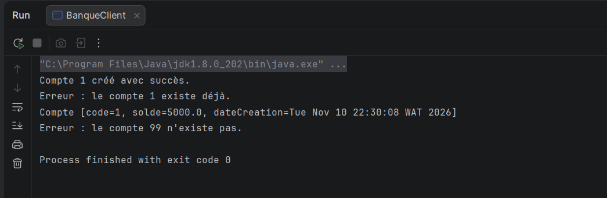

---

# Organisation finale du projet

Après avoir terminé les deux activités et les tests, nous avons regroupé les projets dans un seul dossier afin de faciliter le dépôt du TP avec :

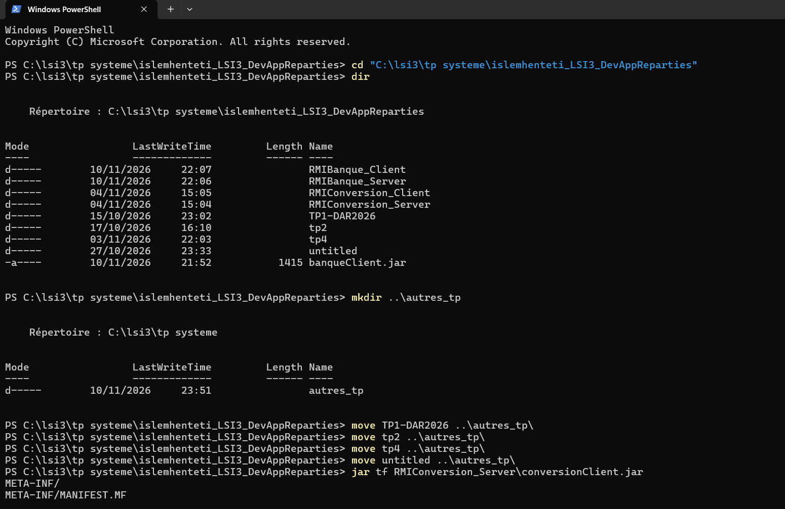
Le dossier principal contient les deux projets de l'activité 5-1, les deux projets de l'activité 5-2, le fichier README et les captures d'écran.

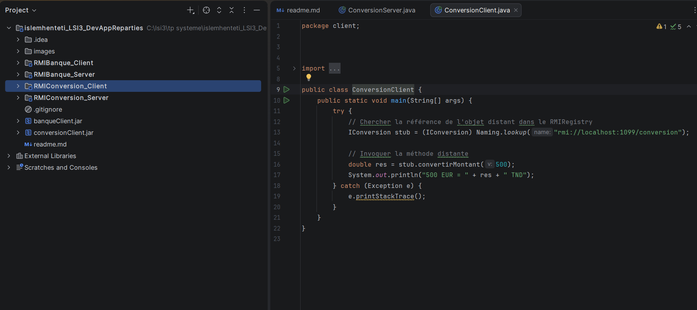

---

# Conclusion

Ce TP nous a permis de comprendre et de mettre en pratique le fonctionnement de Java RMI pour développer des applications réparties selon une architecture client-serveur.

Dans la première activité, nous avons réalisé un service de conversion de devise permettant au client d'invoquer une méthode distante.

Dans la deuxième activité, nous avons développé un service bancaire permettant de créer et de consulter des comptes à distance.

Enfin, nous avons utilisé JNDI pour enregistrer et rechercher le service bancaire à partir d'un nom, en utilisant les méthodes `rebind()` et `lookup()`.

Ces deux activités nous ont permis de mieux comprendre la communication entre objets distants et les mécanismes de publication et de recherche des services en Java.
